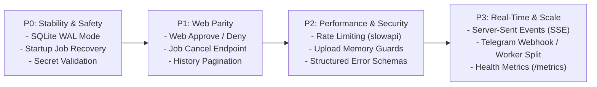

# Marketing Agent Backend API — Audit & Improvement Report

**Date:** October 2026  
**Target:** Backend Services (`api/app/`), Runtimes, Database, & Integrations  
**Status:** Evaluation & Strategic Recommendations  

---

## 1. Executive Summary

The **Marketing Agent Backend** is a unified FastAPI and Python runtime engineered to automate the end-to-end creative lifecycle for short-form social video marketing (9:16 vertical video). It orchestrates a multi-stage pipeline:
1. **Concept & Copywriting:** Gemini LLM generates hooks, briefs, captions, and structured scene shot lists (bilingual in Khmer and English).
2. **Video Generation & Finishing:** Headless NotebookLM client synthesizes visual/audio narratives, followed by an FFmpeg post-processing pipeline that applies dynamic text overlays, subtitles, and branded end-cards.
3. **Approval Gating & Publishing:** Dual-interface approval system via Telegram inline bot callbacks and Facebook Graph API page video uploads.

This audit evaluates the backend architecture across **job lifecycle resilience, database concurrency, security posture, process scaling, and API ergonomics**. While the core domain logic is well-factored and modular, this report identifies critical vulnerabilities—including unhandled job state during process restarts, SQLite lock contention, hardcoded cryptographic fallback secrets, and an architectural gap between web capabilities and Telegram-only approval gates.

---

## 2. Architecture & Service Flow Overview

```
┌────────────────────────────────────────────────────────────────────────┐
│                        FastAPI Web API (Uvicorn)                      │
│   Auth (/api/auth) │ Jobs & Storyboards (/api/jobs) │ Integrations    │
└──────────────────┬───────────────────────────────┬─────────────────────┘
                   │                               │
┌──────────────────▼─────────────┐   ┌─────────────▼─────────────────────┐
│    Shared Runtime Dataclass    │   │      Telegram Bot Engine          │
│  - Task tracking (_running)    │   │  - python-telegram-bot polling    │
│  - Account settings resolution │   │  - Inline keyboard approval gate  │
└──────────────────┬─────────────┘   └─────────────┬─────────────────────┘
                   │                               │
┌──────────────────▼───────────────────────────────▼─────────────────────┐
│                       Pipeline Orchestrator                            │
│                                                                        │
│  [Gemini LLM] ──► [NotebookLM] ──► [FFmpeg Finishing] ──► [Facebook API]│
└──────────────────────────────────┬─────────────────────────────────────┘
                                   │
┌──────────────────────────────────▼─────────────────────────────────────┐
│                        Persistence Layer                               │
│  - jobs.db (JobStore)          - users.db (UserStore)                  │
│  - integrations.db (Fernet)    - promotions.db (PromotionStore)        │
└────────────────────────────────────────────────────────────────────────┘
```

### Current Architectural Strengths:
- **Clean Domain Separation:** Pipeline execution, LLM prompting, Telegram handlers, Facebook OAuth, and video finishing are organized into distinct, testable modules.
- **Account Isolation & Secret Encryption:** User-specific Telegram tokens and Gemini API keys are encrypted at rest using AES-128-CBC/HMAC Fernet cryptography (`app.integrations.crypto`).
- **High-Fidelity Prompting & Verification:** Built-in safeguards (`_assert_no_invented_claims`) strictly prevent hallucinations and invented discount percentages in guided business campaigns.
- **Bilingual Khmer/English Pipeline:** Robust handling of Khmer Unicode text rendering, font fallbacks, and localized system prompts.

---

## 3. Key Findings & Vulnerability Analysis

### 3.1 Job Lifecycle & Process Crash Recovery
* **Issue — Zombie / Stuck Jobs on Process Restart:**
  - Background generation jobs are spawned via `asyncio.create_task(self.pipeline.run_generation(job_id))` and tracked exclusively in an ephemeral, in-memory set (`_running: set[str]`).
  - *Impact:* If the server process restarts (deployments on Render/Heroku, OOM kills during FFmpeg rendering, or OS reboot) while jobs are in `JobStatus.GENERATING`, `JobStatus.QUEUED`, or `JobStatus.POSTING`, their database records remain frozen in those statuses forever. Users see an indefinite spinning indicator in the web app with no recovery path.
* **Issue — Missing Job Cancellation Mechanism:**
  - `JobStatus.CANCELLED` exists in SQLite enum declarations, but no endpoint exposes `POST /api/jobs/{job_id}/cancel`.
  - *Impact:* If a job hangs during NotebookLM extraction or if a user discovers an error in their brief after starting generation, there is no way to terminate the process or free resources.

### 3.2 Database Concurrency & SQLite Lock Contention
* **Issue — Missing WAL (Write-Ahead Logging) Mode:**
  - `JobStore`, `UserStore`, and `IntegrationStore` connect via standard `sqlite3.connect(self.db_path)`.
  - *Impact:* Standard SQLite uses rollback journals where any write lock blocks all concurrent readers. With the frontend polling `GET /api/jobs` every 2.5 seconds while FFmpeg or NotebookLM executes background writes, the API is prone to `sqlite3.OperationalError: database is locked`.
* **Issue — Default Busy Timeout:**
  - Connections do not explicitly configure `busy_timeout`. Under moderate concurrent API traffic, SQLite fails immediately after 5 seconds of contention instead of waiting for transactions to finish.

### 3.3 Security, Secret Management & Authentication
* **Issue — Hardcoded Cryptographic Dev Fallbacks:**
  - `_auth_secret()` in `app.auth.security` and `_fernet()` in `app.integrations.crypto` default to `"marketing-agent-dev-secret-change-me"`.
  - *Impact:* If an operator fails to set `AUTH_SECRET` in production `.env`, all user JWT sessions can be forged, and encrypted Facebook Page Access Tokens can be decrypted by any party with access to the source code.
* **Issue — Lack of Rate Limiting on Costly Endpoints:**
  - Endpoints that invoke paid or rate-limited external APIs (`/api/campaign-drafts`, `/api/jobs/{job_id}/revise`, `/api/jobs/{job_id}/render`) and authentication routes (`/api/auth/login`) have no request throttling.
  - *Impact:* A single looping client or malicious actor can deplete daily Gemini API quotas or brute-force user passwords.
* **Issue — Unbuffered Large Asset Reads:**
  - `save_job_assets()` loads uploaded files into memory with `await upload.read()`.
  - *Impact:* While single file sizes are checked against 5 MB, multiple concurrent multipart uploads could spike memory usage in resource-constrained container environments.

### 3.4 Approval Gate Decoupling & Web UI Parity
* **Issue — Telegram-Only Publishing Approval:**
  - While the React dashboard provides a full video player (`GET /api/jobs/{job_id}/video`) and status tracking, the actions to **Approve** (publish to Facebook) and **Deny** exist exclusively inside `TelegramBotHub` inline callbacks (`app/telegram_bot/handlers.py`).
  - *Impact:* The web app cannot function as an independent, standalone application. A user without Telegram cannot trigger publishing from their browser.

### 3.5 Process Architecture & Worker Scaling Conflicts
* **Issue — In-Process Telegram Polling vs. Multi-Worker Uvicorn:**
  - `app/main.py` binds Uvicorn and starts Telegram's `Application.updater.start_polling()` in the same event loop.
  - *Impact:* If Uvicorn is launched with multiple workers (e.g., `uvicorn app.main:web_app --workers 4`), every worker process attempts to poll the same Telegram bot token, triggering Telegram's fatal `Conflict: terminated by other getUpdates request`.

### 3.6 API Ergonomics & Pagination
* **Issue — Hard-Capped Job History Without Offset:**
  - `GET /api/jobs` enforces `limit = max(1, min(limit, 50))` and provides no cursor or `offset` parameters.
  - *Impact:* Accounts with more than 50 historical campaigns permanently lose access to older campaigns through the web UI.

---

## 4. Comprehensive Recommendations

### Recommendation 1: Job Lifecycle Hardening & Crash Recovery
1. **Startup Reconciliation Routine:**
   - Execute an automatic reconciliation check during `init_runtime()`:
     ```python
     def reconcile_interrupted_jobs(store: JobStore) -> int:
         stale_jobs = store.list_by_statuses([
             JobStatus.GENERATING, 
             JobStatus.QUEUED, 
             JobStatus.POSTING
         ])
         for job in stale_jobs:
             store.update(
                 job.id,
                 status=JobStatus.FAILED,
                 error="System restarted while processing. Please retry your campaign."
             )
         return len(stale_jobs)
     ```
2. **Job Cancellation Route:**
   - Expose `POST /api/jobs/{job_id}/cancel`.
   - Update `JobStatus.CANCELLED`, cancel the background `asyncio.Task`, and clean up temporary FFmpeg scratch directories.

### Recommendation 2: Database Concurrency Optimization
1. **Enable WAL Mode & Extended Busy Timeout:**
   - Upgrade connection initializers across all store classes:
     ```python
     @contextmanager
     def _connect(self) -> Iterator[sqlite3.Connection]:
         conn = sqlite3.connect(self.db_path, timeout=30.0)
         conn.execute("PRAGMA journal_mode = WAL;")
         conn.execute("PRAGMA busy_timeout = 30000;")
         conn.execute("PRAGMA synchronous = NORMAL;")
         conn.row_factory = sqlite3.Row
         try:
             yield conn
             conn.commit()
         except Exception:
             conn.rollback()
             raise
         finally:
             conn.close()
     ```
   - *Result:* Eliminates read/write contention and guarantees zero locks during high-frequency status queries.

### Recommendation 3: Security & Secret Management
1. **Production Secret Enforcement:**
   - Add a startup validator in `app/config.py`:
     - If `ENVIRONMENT == "production"` and `AUTH_SECRET` is default/missing, raise an immediate `RuntimeError` preventing unsafe boots.
     - In development, emit a prominent warning log on startup.
2. **Rate Limiting with `slowapi`:**
   - Attach a lightweight rate limiter to costly endpoints:
     - Auth endpoints (`/api/auth/login`): 5 attempts/minute.
     - Gemini draft/revision endpoints: 10 requests/minute per user.
     - Video render endpoints: 3 requests/minute per user.

### Recommendation 4: Complete Web UI Parity
1. **Direct Web Approval & Denial Endpoints:**
   - Add first-class endpoints in `app/webapp.py`:
     - `POST /api/jobs/{job_id}/approve`: Validates ownership, checks status `AWAITING_APPROVAL`, and calls `pipeline.approve(job_id)`.
     - `POST /api/jobs/{job_id}/deny`: Validates ownership and calls `pipeline.deny(job_id)`.
   - *Result:* Enables pure browser-based workflows without requiring Telegram setup.

### Recommendation 5: Real-Time Event Streaming (SSE)
1. **Replace Polling with Server-Sent Events:**
   - Implement `GET /api/jobs/{job_id}/events` using `starlette.responses.EventSourceResponse`.
   - Stream structured stage progression (`drafting_script` → `generating_video` → `finishing_ffmpeg` → `awaiting_approval`) directly to the web client.

### Recommendation 6: Worker Process Decoupling
1. **Dedicated Worker Architecture:**
   - Split application entrypoints for production:
     - `api/run_web.py`: Runs pure Uvicorn with multiple workers for the HTTP API.
     - `api/run_bot.py`: Runs the singleton Telegram polling hub and background queue processor.
   - Or alternatively, support Telegram Webhooks (`setWebhook`) to route bot updates through the FastAPI HTTP router.

---

## 5. Prioritized Implementation Roadmap



### Phase 1: Immediate Wins (Stability & Data Integrity)
- Enable SQLite WAL mode (`PRAGMA journal_mode = WAL`) and 30-second timeout in `JobStore`, `UserStore`, and `IntegrationStore`.
- Implement startup interrupted job reconciliation in `Runtime.init_runtime`.
- Add startup validation for `AUTH_SECRET` in production.

### Phase 2: Feature Parity & Control
- Implement `POST /api/jobs/{job_id}/approve` and `POST /api/jobs/{job_id}/deny` in `app/webapp.py`.
- Add `POST /api/jobs/{job_id}/cancel` to abort active or queued jobs.
- Add `offset` or cursor-based pagination to `GET /api/jobs`.

### Phase 3: Performance, Security & Real-Time
- Add IP and user-based rate limiting via `slowapi` to Gemini and auth endpoints.
- Introduce Server-Sent Events (`/api/jobs/{job_id}/events`) to eliminate 2.5s client polling.
- Stream file uploads directly to disk in chunks to optimize memory footprint.

### Phase 4: Production Scalability
- Migrate Telegram bot from polling to Webhooks or isolate polling into a separate background service.
- Implement structured health checks (`/api/health/ready` and `/api/health/live`) reporting SQLite, Telegram, and Gemini status.

---

## 6. Endpoints & Modules Audit Matrix

| File / Component | Current Implementation | Identified Issue / Risk | Recommended Upgrade |
| :--- | :--- | :--- | :--- |
| `app/runtime.py` | In-memory `_running: set[str]` task set | Jobs freeze on crash/restart; no cleanup | Startup reconciliation routine; task cancellation tracking |
| `app/jobs/store.py` | Standard SQLite rollback journal | Database locks during concurrent polling/writes | WAL mode (`PRAGMA journal_mode = WAL;`) & 30s busy timeout |
| `app/webapp.py` | Telegram-only approvals | Web dashboard cannot publish or reject | Expose `POST /api/jobs/{id}/approve` & `/deny` |
| `app/webapp.py` | `min(limit, 50)` on `GET /api/jobs` | Historical jobs > 50 are inaccessible | Add `offset: int = 0` pagination query parameter |
| `app/auth/security.py` | Dev fallback string for HMAC tokens | Security vulnerability if `AUTH_SECRET` unset | Throw error in production; require 32+ char secret |
| `app/integrations/crypto.py`| Dev fallback string for Fernet cipher | Encrypted Facebook tokens vulnerable | Fail-fast validation in production mode |
| `app/main.py` | In-process bot polling with Uvicorn | `workers > 1` triggers Telegram polling conflict | Separate worker processes or migrate to Telegram Webhook |
| `app/uploads.py` | In-memory buffer `read()` | Memory spike on concurrent multi-image uploads | Chunked stream-to-disk writing |
| `app/llm/caption.py` | Multi-key rotation with mutex lock | No rate limiting; API quota exhaustion risk | Add per-user rate limiting & token usage telemetry |

---

*Report prepared for the Marketing Agent project. Use this reference alongside `doc/WEB_APP_AUDIT_REPORT.md` to guide backend stability, security hardening, and API feature enhancements.*
