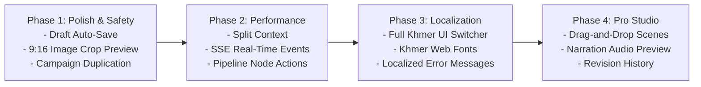

# Marketing Agent Web Application — Audit & Improvement Report

**Date:** October 2026  
**Target:** Web Frontend (`web/`) & System Integrations (`api/`)  
**Status:** Evaluation & Strategic Recommendations  

---

## 1. Executive Summary

The **Marketing Agent** web dashboard is a focused, human-in-the-loop creative platform designed to turn simple business briefs into multi-scene short-form vertical videos (9:16). It uniquely integrates **Gemini** for concept generation, **human review/storyboarding** on the web, video generation via **NotebookLM & FFmpeg**, final approval gates in **Telegram**, and publishing via the **Facebook Graph API**.

This audit evaluates the web application across architecture, user experience, creative authoring, state management, localization (Khmer/English), and scalability. Overall, the foundational architecture is clean, purposeful, and lightweight (zero unnecessary UI framework overhead). However, there are significant opportunities to enhance authoring ergonomics, real-time performance, draft safety, and end-to-end multi-tenant usability.

---

## 2. Architecture & Tech Stack Overview

```
┌─────────────────────────────────────────────────────────────┐
│                       Web Frontend (React 19)              │
│  - Vite 6 + React Router 7                                  │
│  - Vanilla CSS design system (styles.css ~1.1k lines)       │
│  - Multi-step Campaign Composer (Steps 0–4)                 │
│  - Scene & Hook Storyboard Editor (Step 5)                  │
│  - Live Pipeline Canvas (SVG) & Campaign History            │
└──────────────────────────────┬──────────────────────────────┘
                               │ REST / Blob streaming
┌──────────────────────────────▼──────────────────────────────┐
│                       Backend API (FastAPI)                 │
│  - SQLite storage (JobStore, PromotionStore, UserStore)     │
│  - Gemini LLM (Hooks, scripts, scene directions)            │
│  - NotebookLM client + FFmpeg finishing pass                │
│  - Telegram Bot Hub & Callback handlers                     │
│  - Facebook OAuth & Video Publisher                         │
└─────────────────────────────────────────────────────────────┘
```

### Current Strengths:
- **Zero Heavyweight Framework Bloat:** Fast Vite build (~700ms), pure CSS tokens, clean semantic HTML.
- **First-Class Khmer (`km`) Support:** Prompt templates, native business presets (Phnom Penh café, skincare, mobile apps), and FFmpeg complex font shaping instructions.
- **Iterative Storyboarding:** Provides 3 opening hooks and scene-by-scene editing (narration, screen text, visual direction, image mapping) instead of opaque black-box AI video generation.
- **Verified Core Test Suite:** 13 native Node unit tests ensuring payload normalization, duration validation, prompt length enforcement, and step constraints.

---

## 3. Key Findings & Detailed Analysis

### 3.1 State Management & Real-Time Sync
* **Issue — Monolithic `DashboardContext.jsx` (448 lines):**
  - Bundles global health monitoring, business profile CRUD, multi-step campaign draft state, storyboard script edits, active job tracking, and auto-polling into a single React context.
  - *Impact:* High-frequency user typing inside scene textareas triggers re-renders across consumers of the dashboard context.
* **Issue — Aggressive HTTP Polling (2.5s / 8s):**
  - While a campaign is running (generating script, rendering video, or awaiting Telegram approval), the client polls `GET /api/jobs` every 2500ms.
  - Video finishing and NotebookLM take between 30 and 90 seconds, causing unnecessary HTTP overhead and potential rate-limit issues on slow connections.
* **Issue — Risk of In-Flight Draft Loss:**
  - Campaign creation steps (0 to 4) live purely in React memory. If a user accidentally refreshes the browser, closes the tab, or encounters a network glitch before Step 5, all draft data is wiped.

### 3.2 Storyboard & Creative Experience (Step 5)
* **Issue — Vertical Form Stack vs. Visual Storyboard:**
  - The storyboard editor (`StoryboardEditor.jsx`) renders scenes as a vertical list of form fields. Modern creators (CapCut, Canva, Descript) expect visual cards with a scrubbable timeline.
* **Issue — Lack of Scene Drag-and-Drop Reordering:**
  - Users can add or delete scenes, but cannot reorder them. If a user wants Scene 3 before Scene 2, they must manually cut and paste text across inputs.
* **Issue — Blind Audio Pacing (No TTS Preview):**
  - Users write narration without hearing the spoken cadence, word timing, or Khmer pronunciation until the entire video is rendered.
* **Issue — Aspect Ratio Mismatches for Uploaded Media:**
  - Users can attach up to 5 photos/logos, but there is no cropping tool. Uploading a landscape photo (16:9) leads to automatic cropping or letterboxing during the FFmpeg 9:16 vertical finishing pass without visual confirmation.
* **Issue — Single-Shot AI Revisions (No Version History):**
  - Clicking "Stronger opening" or "Make it shorter" overwrites the script. There is no undo/redo or revision comparison history if the user preferred an earlier iteration.

### 3.3 Localization & Cambodian Market Readiness
* **Issue — English-Only Dashboard Interface:**
  - While campaigns can generate Khmer content, the dashboard UI (buttons, labels, guidance banners, error messages, and guide page) is entirely in English.
  - *Impact:* Cambodian shop owners and non-technical business managers face unnecessary language barriers.
* **Issue — Web Font Uniformity:**
  - System Khmer fonts vary widely across devices (Android, Windows, macOS, iOS). Cross-platform web fonts (such as `Noto Sans Khmer` or `Kantumruy Pro`) are not currently bundled or loaded via `@font-face`.

### 3.4 Pipeline Visualization & Campaign History
* **Issue — Static Pipeline Canvas (`PipelinePage.jsx`):**
  - The pipeline flow diagram uses animated SVG dashes, but is non-interactive. Nodes cannot be clicked to inspect job artifacts (e.g., clicking "Script review" does not navigate to the draft, and clicking "Telegram" does not display the bot notification status).
* **Issue — Unfiltered Campaign History:**
  - The campaigns list fetches a fixed limit of 20 jobs with no search bar, status filters (e.g. "Awaiting Approval", "Published", "Failed"), or pagination.
* **Issue — Missing "Clone / Duplicate Campaign" Action:**
  - Users cannot duplicate a previous campaign brief to run a new iteration with an updated discount or seasonal angle.

### 3.5 Integration & Multi-User Settings
* **Issue — Commented-Out Settings Page:**
  - `web/src/pages/dashboard/SettingsPage.jsx` contains 421 lines of robust code for Facebook OAuth, Telegram bot token registration, and Gemini API key management.
  - However, it is commented out in `App.jsx` and `DashboardSidebar.jsx`, deferring configuration to server `.env`.
  - *Impact:* The web app supports multi-user registration and login (`/api/auth/register`), but individual users cannot configure their own Telegram bot or Facebook Page via the UI.

---

## 4. Comprehensive Recommendations

### Recommendation 1: Creative & Storyboard Enhancements
1. **Interactive Storyboard Timeline:**
   - Convert the scene editor into a card-based horizontal scrubber with duration badges and visual drag-and-drop reordering (e.g., via HTML5 Drag and Drop or `@hello-pangea/dnd`).
2. **Audio / Narration Preview (Browser TTS or Gemini Voice):**
   - Add a "Listen" preview button next to each scene's narration input to hear cadence and pronunciation before initiating the full render.
3. **9:16 Visual Framing & Crop Modal:**
   - Introduce client-side image cropping (e.g. `react-easy-crop`) for uploaded images to ensure key subjects remain within the vertical 9:16 safe zone (avoiding caption and UI overlap).
4. **Draft Versioning & History:**
   - Store local revision snapshots when testing AI prompts ("Stronger hook", "Make it shorter") so creators can toggle between versions.

### Recommendation 2: Frontend Architecture & Performance
1. **Modular Context Architecture:**
   - Decompose `DashboardContext.jsx` into three focused domains:
     - `useJobs()`: Polling, real-time connection, active job selection.
     - `useCampaignDraft()`: Steps 0–4 form state, profile loading, and local persistence.
     - `useStoryboard()`: Script draft loading, hook selection, scene edits, and revisions.
2. **Server-Sent Events (SSE) for Real-Time Updates:**
   - Replace 2500ms HTTP polling with an SSE stream (`/api/jobs/{id}/events`):
     - Delivers instant updates when Telegram approves or denies.
     - Emits granular progress stages during video rendering (e.g., `drafting_script`, `rendering_video`, `finishing_ffmpeg`).
3. **Draft Auto-Save & Crash Resilience:**
   - Automatically save form drafts to `localStorage` (debounced by 500ms) with a "Restore unsaved draft" prompt on return.

### Recommendation 3: Full Khmer Localization (i18n)
1. **Bilingual UI Toggle (EN / ភាសាខ្មែរ):**
   - Implement a lightweight translation dictionary or `i18next` covering all navigation links, buttons, form fields, and help banners.
2. **Web Font Embedding:**
   - Import `Kantumruy Pro` and `Noto Sans Khmer` via `@font-face` or Google Fonts in `index.html` to guarantee consistent typography across all operating systems.

### Recommendation 4: Pipeline Interactivity & Operations
1. **Clickable Pipeline Nodes:**
   - Make pipeline nodes interactive: clicking an active or completed node jumps directly to its corresponding asset, log, or external URL (e.g., Telegram preview, Facebook post).
2. **Search, Filter & Duplicate Campaigns:**
   - Add status pill filters (All / Live / Awaiting Telegram / Published / Failed) and a search bar to `JobsPage.jsx`.
   - Add a "Duplicate as New Campaign" action in `JobDetail.jsx`.

### Recommendation 5: Integration Architecture Alignment
1. **Establish Clear Multi-Tenant vs. Single-Tenant Strategy:**
   - **Option A (Self-Hosted / Single-Operator):** Display a clean "Server Managed" indicator in Settings noting that Telegram and Facebook tokens are safely driven by the backend `.env`.
   - **Option B (Multi-Tenant SaaS):** Un-comment and refine `SettingsPage.jsx` with per-user encrypted token storage, guided setup wizards, and bot connectivity verification tests.

---

## 5. Prioritized Implementation Roadmap



### Phase 1: Immediate Wins (Safety & Ergonomics)
- Implement `localStorage` draft auto-save and recovery.
- Add client-side 9:16 vertical crop preview for uploaded photos.
- Add "Duplicate Campaign" button to campaign history.
- Add search and status filter tabs in `JobsPage.jsx`.

### Phase 2: Performance & Architecture
- Break `DashboardContext.jsx` into modular custom hooks (`useJobs`, `useCampaignDraft`, `useStoryboard`).
- Replace 2.5s polling with FastAPI Server-Sent Events (SSE) for live job state changes.
- Add clickable node navigation to the SVG pipeline canvas.

### Phase 3: Cambodian Market Expansion
- Add an English / Khmer language switcher for all dashboard chrome and text.
- Embed optimized Khmer web fonts in `web/index.html`.
- Localize toast notifications, validation errors, and guide explanations.

### Phase 4: Pro Storyboard Studio
- Implement drag-and-drop scene reordering in `StoryboardEditor.jsx`.
- Integrate quick audio/TTS narration preview.
- Add revision undo/redo and snapshot comparison.
- Enable Facebook post performance tracking (views, likes, shares) in completed job details.

---

## 6. Component & Feature Matrix

| Component / File | Current Role | Recommended Upgrade |
| :--- | :--- | :--- |
| `web/src/dashboard/DashboardContext.jsx` | Monolithic state hub (448 LOC) | Decompose into modular hooks; replace polling with SSE |
| `web/src/components/StoryboardEditor.jsx` | Vertical scene form stack | Card timeline, drag-and-drop reordering, TTS preview |
| `web/src/components/ComposeForm.jsx` | 5-step campaign wizard | Client-side 9:16 image cropping, debounced draft auto-save |
| `web/src/components/FlowDiagram.jsx` | Non-interactive SVG canvas | Clickable nodes with step-level status drawer and elapsed timers |
| `web/src/components/JobsList.jsx` | Flat 20-job list | Status tabs (All/Live/Approval/Posted), search input, pagination |
| `web/src/components/JobDetail.jsx` | Job metadata & actions | "Clone Campaign" button, live Facebook post metrics |
| `web/src/pages/dashboard/SettingsPage.jsx`| Commented out in `App.jsx` | Re-enable for multi-tenant SaaS or add clear single-tenant admin banner |
| `web/index.html` / `styles.css` | English-only typography | Embed `Kantumruy Pro` / `Noto Sans Khmer` web fonts |

---

*Report prepared for the Marketing Agent project. For implementation discussions or targeted feature execution, refer to this document.*
