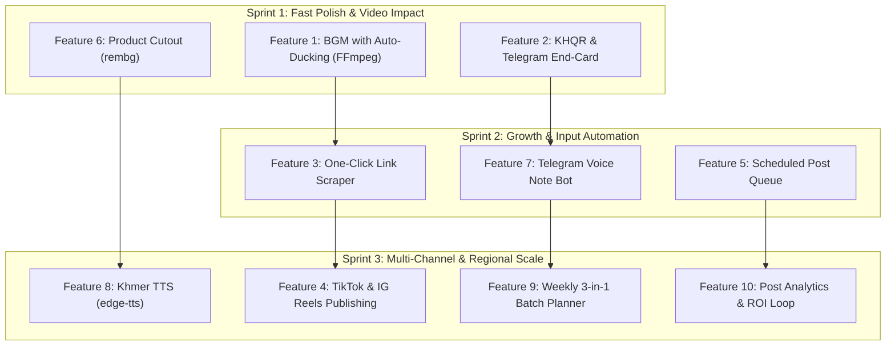

# Marketing Agent — Feature Proposals & Implementation Blueprint

**Version:** 1.0  
**Target Architecture:** FastAPI Backend (`api/`) + React 19 Frontend (`web/`) + FFmpeg Video Engine + Telegram Bot Hub  

---

## Table of Contents

1. [Architectural Overview & Feature Matrix](#1-architectural-overview--feature-matrix)
2. [Feature 1: Background Music (BGM) with Audio Auto-Ducking](#feature-1-background-music-bgm-with-audio-auto-ducking)
3. [Feature 2: KHQR (Bakong) & Telegram Dynamic Animated End-Cards](#feature-2-khqr-bakong--telegram-dynamic-animated-end-cards)
4. [Feature 3: One-Click Campaign Ingestion (URL & Social Scraper)](#feature-3-one-click-campaign-ingestion-url--social-scraper)
5. [Feature 4: Multi-Platform Publishing (TikTok & Instagram Reels)](#feature-4-multi-platform-publishing-tiktok--instagram-reels)
6. [Feature 5: Scheduled Post Queue & Peak-Time Auto-Publisher](#feature-5-scheduled-post-queue--peak-time-auto-publisher)
7. [Feature 6: AI Product Studio Background Remover (`rembg`)](#feature-6-ai-product-studio-background-remover-rembg)
8. [Feature 7: Telegram Voice-Note Campaign Generator (Telegram Agent 2.0)](#feature-7-telegram-voice-note-campaign-generator-telegram-agent-20)
9. [Feature 8: Dedicated Khmer TTS & Voice Persona Engine](#feature-8-dedicated-khmer-tts--voice-persona-engine)
10. [Feature 9: Weekly 3-in-1 Campaign Series Planner](#feature-9-weekly-3-in-1-campaign-series-planner)
11. [Feature 10: Social Performance & ROI Feedback Loop](#feature-10-social-performance--roi-feedback-loop)
12. [Step-by-Step Implementation Roadmap](#step-by-step-implementation-roadmap)

---

## 1. Architectural Overview & Feature Matrix

The table below outlines the proposed features, their implementation complexity, system dependencies, and user impact:

| # | Feature | Impact | Complexity | Core Dependencies | Primary Files Affected |
|---|---|---|---|---|---|
| **1** | **BGM with Auto-Ducking** | 🔥 Very High | Medium | FFmpeg `sidechaincompress`, Audio assets | `api/app/video_finishing.py`, `web/src/components/StoryboardEditor.jsx` |
| **2** | **KHQR & Telegram End-Card** | 🔥 Very High | Low | Python `qrcode`, `Pillow`, FFmpeg | `api/app/video_finishing.py`, `web/src/components/ComposeForm.jsx` |
| **3** | **One-Click URL Ingestion** | 🔥 Very High | Medium | `httpx`, `BeautifulSoup4`, Gemini Flash | `api/app/webapp.py`, `web/src/components/ComposeForm.jsx` |
| **4** | **TikTok & IG Reels Posting** | 🔥 Very High | High | TikTok Content Posting API, Instagram Graph API | `api/app/integrations/`, `api/app/jobs/pipeline.py` |
| **5** | **Scheduled Post Queue** | High | Medium | `APScheduler` or `asyncio` task, SQLite | `api/app/runtime.py`, `api/app/telegram_bot/handlers.py` |
| **6** | **Product Studio (`rembg`)** | High | Low | `rembg`, `onnxruntime`, `Pillow` | `api/app/uploads.py`, `web/src/components/ComposeForm.jsx` |
| **7** | **Telegram Voice Input** | High | Medium | `python-telegram-bot`, Gemini Multimodal Audio | `api/app/telegram_bot/handlers.py`, `api/app/llm/` |
| **8** | **Khmer TTS Engine** | High | Medium | `edge-tts` or Google Cloud TTS | `api/app/llm/tts.py`, `api/app/video_finishing.py` |
| **9** | **Weekly 3-in-1 Planner** | Medium | Medium | Gemini Prompt Engineering, React UI | `api/app/webapp.py`, `web/src/pages/dashboard/ComposePage.jsx` |
| **10**| **Social Analytics Loop** | Medium | Medium | Meta Graph Insights API, Cron Worker | `api/app/facebook/insights.py`, `web/src/components/JobDetail.jsx` |

---

## Feature 1: Background Music (BGM) with Audio Auto-Ducking

### Problem Statement
Raw generated videos without background music sound sterile and empty like an unedited podcast. However, simply overlaying static music can drown out narration.

### Solution
1. Maintain a curated set of royalty-free background tracks stored in `api/assets/audio/bgm/`:
   - `upbeat_commercial.mp3`
   - `cozy_lofi.mp3`
   - `energetic_trend.mp3`
   - `acoustic_warmth.mp3`
2. Allow the user to select the BGM track and volume intensity in the Storyboard Editor.
3. In `video_finishing.py`, use FFmpeg's `sidechaincompress` audio filter: **the background music automatically lowers its volume by 70–80% whenever speech is detected and smoothly rises during pauses**.

### Implementation Steps

#### 1. Backend: Audio Mixing in `api/app/video_finishing.py`
```python
def apply_bgm_with_ducking(
    video_path: Path,
    bgm_path: Path,
    output_path: Path,
    bgm_volume: float = 0.25,
) -> None:
    """Combines video speech audio with background music using sidechain compression."""
    # Sidechain compression filter:
    # 1. Split speech audio into [sc] (sidechain trigger) and [speak]
    # 2. Lower BGM volume by default
    # 3. Compress BGM whenever [sc] has audio energy
    # 4. Mix speech and ducked BGM together
    filter_complex = (
        f"[0:a]asplit=2[sc][speak];"
        f"[1:a]volume={bgm_volume}[bgm_low];"
        f"[bgm_low][sc]sidechaincompress=threshold=0.08:ratio=5:attack=100:release=600[ducked_bgm];"
        f"[speak][ducked_bgm]amix=inputs=2:duration=first:dropout_transition=2[aout]"
    )

    cmd = [
        "ffmpeg", "-y",
        "-i", str(video_path),
        "-stream_loop", "-1", "-i", str(bgm_path),  # Loop BGM if video is longer
        "-filter_complex", filter_complex,
        "-map", "0:v",
        "-map", "[aout]",
        "-c:v", "copy",
        "-c:a", "aac",
        "-b:a", "192k",
        "-shortest",
        str(output_path),
    ]
    subprocess.run(cmd, check=True)
```

#### 2. Frontend: Storyboard Editor UI (`web/src/components/StoryboardEditor.jsx`)
Add a BGM selection dropdown in the script editor header:
```jsx
<label className="storyboard-bgm-field">
  <span>Background Music</span>
  <select value={storyboard.bgm_track || "cozy_lofi"} onChange={(e) => change("bgm_track", e.target.value)}>
    <option value="none">No music</option>
    <option value="upbeat_commercial">Upbeat Commercial</option>
    <option value="cozy_lofi">Cozy Lo-Fi (Café / Casual)</option>
    <option value="energetic_trend">Energetic Trend</option>
    <option value="acoustic_warmth">Acoustic Warmth</option>
  </select>
</label>
```

---

## Feature 2: KHQR (Bakong) & Telegram Dynamic Animated End-Cards

### Problem Statement
In Cambodia and Southeast Asia, marketing videos usually fail to convert if they don't provide an immediate payment or direct chat link. Customers do not copy URLs; they scan **KHQR** (Bakong) or open **Telegram**.

### Solution
1. In `ComposeForm.jsx`, let business owners input their Telegram username (e.g. `@soriyacoffee`) or upload their Bakong KHQR image.
2. In `video_finishing.py`, generate a high-contrast 3-second animated ending card:
   - Centered shop logo / product name.
   - Dynamic QR code linking to `https://t.me/username` or rendering the KHQR code.
   - Clear CTA overlay: *"ស្កេនដើម្បីបញ្ជាទិញ / Scan to Order on Telegram"*.

### Implementation Steps

#### 1. QR Code Generator in `api/app/video_finishing.py`
Add dependency: `qrcode[pil]>=7.4`
```python
import qrcode
from PIL import Image, ImageDraw, ImageFont

def render_qr_endcard(
    cta_text: str,
    qr_data: str,
    business_name: str,
    output_path: Path,
    width: int = 720,
    height: int = 1280,
) -> Path:
    # 1. Generate QR Code
    qr = qrcode.QRCode(box_size=10, border=2)
    qr.add_data(qr_data)
    qr.make(fit=True)
    qr_img = qr.make_image(fill_color="#111827", back_color="#ffffff").convert("RGBA")
    qr_img = qr_img.resize((360, 360), Image.Resampling.LANCZOS)

    # 2. Build 9:16 Canvas
    canvas = Image.new("RGBA", (width, height), (17, 24, 39, 255)) # Dark slate bg
    draw = ImageDraw.Draw(canvas)

    # 3. Paste QR in center
    qr_x = (width - 360) // 2
    qr_y = (height - 360) // 2 - 40
    canvas.paste(qr_img, (qr_x, qr_y), qr_img)

    # 4. Add Text Headers & CTA
    # Draw business_name at top, cta_text below QR
    canvas.save(output_path, "PNG")
    return output_path
```

#### 2. Stitching with FFmpeg
Overlay the generated PNG for the last 3.5 seconds of the video using FFmpeg:
```bash
ffmpeg -i video.mp4 -i endcard.png -filter_complex "[0:v][1:v]overlay=0:0:enable='between(t,DURATION-3.5,DURATION)'[vout]" -map "[vout]" -map 0:a -c:v libx264 -c:a copy output.mp4
```

---

## Feature 3: One-Click Campaign Ingestion (URL & Social Scraper)

### Problem Statement
Manually entering business details, customer benefits, target audience, and brand copy into forms creates onboarding friction.

### Solution
Provide a single input: **"Import from Link"**. Users paste their website URL or Facebook page. The agent extracts metadata, summarizes key selling points, and populates the entire campaign brief automatically.

### Implementation Steps

#### 1. Backend Endpoint: `POST /api/campaign/ingest`
Add dependencies: `httpx>=0.27.0`, `beautifulsoup4>=4.12.0`

```python
# api/app/webapp.py
from bs4 import BeautifulSoup
import httpx
import json

class IngestUrlRequest(BaseModel):
    url: str

@app.post("/api/campaign/ingest")
async def ingest_url(req: IngestUrlRequest, current_user = Depends(get_current_user)):
    async with httpx.AsyncClient(timeout=10.0, follow_redirects=True) as client:
        resp = await client.get(req.url, headers={"User-Agent": "Mozilla/5.0 (MarketingAgent/1.0)"})
        if resp.status_code != 200:
            raise HTTPException(status_code=400, detail="Could not retrieve webpage content.")

    soup = BeautifulSoup(resp.text, "html.parser")
    title = soup.title.string if soup.title else ""
    meta_desc = (soup.find("meta", attrs={"name": "description"}) or {}).get("content", "")
    og_image = (soup.find("meta", attrs={"property": "og:image"}) or {}).get("content", "")

    # Extract clean text chunks
    paragraphs = [p.get_text().strip() for p in soup.find_all(["p", "h1", "h2", "h3"]) if p.get_text().strip()]
    raw_content = " ".join(paragraphs[:15])[:3000]

    # Ask Gemini Flash to extract structured campaign draft
    llm_prompt = f"""
    Analyze this business webpage and extract structured facts for a short-form video campaign:
    URL: {req.url}
    Title: {title}
    Meta Description: {meta_desc}
    Text: {raw_content}

    Respond ONLY in JSON with these exact fields:
    {{
      "name": "Business or product name",
      "kind": "shop|product|service|other",
      "description": "Short explanation of what it is",
      "benefit": "Core value proposition or benefit",
      "location": "Address or city if mentioned, else empty",
      "website": "{req.url}",
      "goal": "sales|awareness|launch",
      "cta": "visit|message|buy|learn"
    }}
    """
    settings = resolve_settings_for_account(current_user.id)
    structured_data = extract_json_with_gemini(settings, llm_prompt)
    return {"draft": structured_data, "og_image": og_image}
```

#### 2. Frontend Integration (`web/src/components/ComposeForm.jsx`)
Add an "Auto-Fill from Website or Social Link" banner at Step 0:
- A text input for the URL + "Import" button.
- A loading spinner while Gemini parses the page.
- Fields pre-populate instantly with high accuracy.

---

## Feature 4: Multi-Platform Publishing (TikTok & Instagram Reels)

### Problem Statement
Currently, publishing is limited to Facebook Pages. Marketers waste time manually downloading videos from Telegram and re-uploading them to TikTok and Instagram.

### Solution
Extend the integration layer to authenticate with the **TikTok Content Posting API** and **Instagram Graph API**. When Telegram approves, the agent dispatches the video to all selected channels simultaneously.

### Architecture

```
Telegram [Approve]
      │
      ▼
Pipeline.publish_approved_video()
      ├─► Facebook Page Graph API (/videos)
      ├─► Instagram Graph API (/media + /media_publish for REELS)
      └─► TikTok Creator API (/v2/post/publish/video/init/)
```

### Implementation Blueprint

#### 1. Instagram Graph API Integration (`api/app/integrations/instagram.py`)
```python
async def post_instagram_reel(page_access_token: str, ig_user_id: str, video_public_url: str, caption: str) -> str:
    """Publishes a vertical 9:16 video as an Instagram Reel."""
    async with httpx.AsyncClient() as client:
        # Step 1: Create media container
        init_res = await client.post(
            f"https://graph.facebook.com/v19.0/{ig_user_id}/media",
            data={
                "media_type": "REELS",
                "video_url": video_public_url,
                "caption": caption,
                "share_to_feed": "true",
                "access_token": page_access_token,
            }
        )
        container_id = init_res.json().get("id")

        # Step 2: Poll container status until FINISHED
        for _ in range(30):
            await asyncio.sleep(3)
            status_res = await client.get(
                f"https://graph.facebook.com/v19.0/{container_id}",
                params={"fields": "status_code", "access_token": page_access_token}
            )
            if status_res.json().get("status_code") == "FINISHED":
                break

        # Step 3: Publish container
        pub_res = await client.post(
            f"https://graph.facebook.com/v19.0/{ig_user_id}/media_publish",
            data={"creation_id": container_id, "access_token": page_access_token}
        )
        return pub_res.json().get("id")
```

#### 2. TikTok Content Posting API (`api/app/integrations/tiktok.py`)
- Endpoint: `https://open.tiktokapis.com/v2/post/publish/video/init/`
- Header: `Authorization: Bearer <USER_TIKTOK_ACCESS_TOKEN>`
- Body:
```json
{
  "post_info": {
    "title": "Campaign caption with #hashtags",
    "privacy_level": "PUBLIC_TO_EVERYONE",
    "disable_duet": false,
    "disable_comment": false
  },
  "source_info": {
    "source": "PULL_FROM_URL",
    "video_url": "https://your-public-cdn-domain.com/videos/job-123.mp4"
  }
}
```

---

## Feature 5: Scheduled Post Queue & Peak-Time Auto-Publisher

### Problem Statement
Approving a video in Telegram at 11:00 PM currently publishes it immediately, when viewers are asleep and social engagement is lowest.

### Solution
1. Add an optional `publish_at` timestamp to the campaign job.
2. Provide Telegram inline buttons:
   - `[🚀 Post Now]`
   - `[⏰ Schedule: Tonight 7:00 PM]`
   - `[☀️ Schedule: Tomorrow 11:30 AM]`
3. An internal background ticker in FastAPI checks every minute for pending scheduled jobs and executes publishing.

### Implementation Blueprint

#### 1. Database Schema Update (`api/app/jobs/store.py`)
Add columns to the `jobs` SQLite table:
```sql
ALTER TABLE jobs ADD COLUMN scheduled_at TEXT DEFAULT NULL;
ALTER TABLE jobs ADD COLUMN published_at TEXT DEFAULT NULL;
```

#### 2. Async Queue Worker in `api/app/runtime.py`
```python
async def scheduled_post_worker(store: JobStore, pipeline: Pipeline):
    """Checks every 60 seconds for approved jobs ready to be published."""
    while True:
        try:
            now_iso = datetime.now(timezone.utc).isoformat()
            due_jobs = store.find_scheduled_ready(now_iso)
            for job in due_jobs:
                logger.info(f"Triggering scheduled publish for job {job.id}")
                await pipeline.publish_approved_job(job.id)
        except Exception:
            logger.exception("Error in scheduled_post_worker ticker")
        await asyncio.sleep(60)
```

---

## Feature 6: AI Product Studio Background Remover (`rembg`)

### Problem Statement
Small business owners upload photos of their products taken on kitchen tables or desk counters. Raw backgrounds look unprofessional in vertical marketing ads.

### Solution
Integrated one-click AI background removal. Automatically isolates the product and composites it onto a clean, aesthetic studio backdrop (minimalist podium, warm wood, or soft gradient) before rendering.

### Implementation Blueprint

#### 1. Backend Processing in `api/app/uploads.py`
Add dependencies: `rembg>=2.0.50`, `onnxruntime`
```python
from rembg import remove
from PIL import Image, ImageFilter

def create_product_studio_asset(input_path: Path, output_path: Path, bg_color: tuple = (245, 245, 247)) -> Path:
    """Isolates product, adds a soft contact shadow, and centers on studio background."""
    input_img = Image.open(input_path).convert("RGBA")
    
    # 1. Remove background
    cutout = remove(input_img)
    
    # 2. Generate soft drop shadow
    shadow = Image.new("RGBA", cutout.size, (0, 0, 0, 0))
    alpha = cutout.split()[3]
    shadow_mask = alpha.point(lambda p: 60 if p > 0 else 0)
    shadow.paste((0, 0, 0, 120), mask=shadow_mask)
    shadow = shadow.filter(ImageFilter.GaussianBlur(15))
    
    # 3. Create vertical studio canvas (720x1280)
    canvas = Image.new("RGBA", (720, 1280), bg_color + (255,))
    
    # Scale cutout to fit 70% width
    target_w = int(720 * 0.7)
    ratio = target_w / cutout.width
    target_h = int(cutout.height * ratio)
    cutout = cutout.resize((target_w, target_h), Image.Resampling.LANCZOS)
    shadow = shadow.resize((target_w, target_h), Image.Resampling.LANCZOS)
    
    pos_x = (720 - target_w) // 2
    pos_y = (1280 - target_h) // 2
    
    # Composite shadow + cutout
    canvas.paste(shadow, (pos_x, pos_y + 20), shadow)
    canvas.paste(cutout, (pos_x, pos_y), cutout)
    
    canvas.convert("RGB").save(output_path, "JPEG", quality=92)
    return output_path
```

---

## Feature 7: Telegram Voice-Note Campaign Generator (Telegram Agent 2.0)

### Problem Statement
Business owners are on the go. Opening a web browser and typing a brief takes time. They prefer sending voice messages.

### Solution
Allow users to send a **15–30 second voice note** to the Telegram bot in English or Khmer. The bot passes the audio directly to Gemini 2.0 Flash (multimodal audio), generates the brief and storyboard, and replies with a web review link or one-tap approve button.

### Implementation Blueprint

#### 1. Telegram Voice Handler (`api/app/telegram_bot/handlers.py`)
```python
from telegram import Update
from telegram.ext import ContextTypes

async def on_voice_message(self, update: Update, context: ContextTypes.DEFAULT_TYPE):
    voice = update.message.voice
    file = await context.bot.get_file(voice.file_id)
    ogg_bytes = await file.download_as_bytearray()

    await update.message.reply_text("🎙️ Listening to your audio and drafting campaign brief…")

    # Pass audio bytes directly to Gemini 2.0 Flash
    prompt = """
    Listen to this audio note from a business owner.
    Extract their business facts, campaign angle, and promotion.
    Format your response as a valid campaign draft JSON.
    """
    draft = await asyncio.to_thread(self.gemini_client.analyze_audio, bytes(ogg_bytes), prompt)

    # Create job in database and send web link
    job = self.store.create_from_draft(draft, owner_id=update.effective_user.id)
    
    keyboard = [
        [InlineKeyboardButton("📝 Review Script on Web", url=f"https://your-domain.com/dashboard/compose?draft={job.id}")],
        [InlineKeyboardButton("⚡ Auto-Generate Video Now", callback_data=f"auto_gen:{job.id}")]
    ]
    await update.message.reply_text(
        f"✅ Brief Created: **{draft.get('name', 'New Campaign')}**\n\n"
        f"🎯 Angle: {draft.get('benefit', '')}\n\n"
        f"Choose next step:",
        reply_markup=InlineKeyboardMarkup(keyboard),
        parse_mode=ParseMode.MARKDOWN
    )
```

---

## Feature 8: Dedicated Khmer TTS & Voice Persona Engine

### Problem Statement
NotebookLM audio generation is primarily English-oriented. For native Khmer marketing campaigns, standard TTS models often sound robotic or mispronounce Khmer words.

### Solution
Integrate high-quality neural Khmer Text-to-Speech (`edge-tts` featuring `km-KH-PisethNeural` and `km-KH-SreymomNeural`, or Google Cloud Text-to-Speech API). Generate high-definition scene narration audio files and mix them directly with video footage.

### Implementation Blueprint

#### 1. Khmer Voice Generator (`api/app/llm/tts.py`)
Add dependency: `edge-tts>=6.1.10`
```python
import edge_tts

KHMER_VOICES = {
    "male": "km-KH-PisethNeural",
    "female": "km-KH-SreymomNeural"
}

async def generate_khmer_audio(text: str, output_path: Path, voice: str = "female") -> Path:
    """Generates natural, human-like Khmer speech audio."""
    voice_name = KHMER_VOICES.get(voice, KHMER_VOICES["female"])
    communicate = edge_tts.Communicate(text=text, voice=voice_name, rate="+5%")
    await communicate.save(str(output_path))
    return output_path
```

#### 2. Stitching into Scenes (`api/app/video_finishing.py`)
In `video_finishing.py`, query audio duration using `ffprobe`. Scale each scene's visual clip to match the exact duration of its generated narration audio, guaranteeing **perfect lipsync and subtitle timing**.

---

## Feature 9: Weekly 3-in-1 Campaign Series Planner

### Problem Statement
Businesses need regular posting (3–5 times per week), but creating campaigns one-by-one is tedious.

### Solution
A **"Plan My Week"** generator in the Compose wizard. With one business profile, Gemini generates a 3-part campaign series:
- **Video 1 (Monday):** Educational / Customer Pain Point.
- **Video 2 (Wednesday):** Social Proof / Hero Product Demonstration.
- **Video 3 (Friday):** Urgency / Weekend Discount & Clear CTA.

### Implementation Blueprint

#### 1. Gemini Prompt Engineering (`api/app/llm/caption.py`)
```python
WEEKLY_PLAN_PROMPT = """
You are a senior social video director.
Create a 3-part vertical video series for this business:
{business_brief}

Generate 3 distinct storyboards formatted as JSON:
1. "awareness": Hook focused on everyday customer problem.
2. "product": Hook focused on why this product works best.
3. "offer": Weekend promotion with urgent CTA.

Ensure each script has 3-4 scenes, hooks, and timings under 45 seconds.
"""
```

#### 2. UI Batch Approval (`web/src/pages/dashboard/ComposePage.jsx`)
Display a 3-tab review switcher (`Monday`, `Wednesday`, `Friday`) allowing the user to approve the entire week's content schedule in one session.

---

## Feature 10: Social Performance & ROI Feedback Loop

### Problem Statement
The marketing loop currently ends at "Posted". Business owners do not know which video hook drove real reach or sales.

### Solution
1. Use Facebook Graph API Insights to query engagement metrics 24 hours and 7 days after publishing:
   - Video 3-second views
   - Average watch duration & retention curve
   - Shares, comments, and link clicks
2. Surface an **Analytics Card** inside `JobDetail.jsx`.
3. Provide an **AI Feedback Prompt**: Gemini analyzes the winning video hook and auto-suggests creative angles for the next campaign.

### Implementation Blueprint

#### 1. Insights Poller (`api/app/facebook/insights.py`)
```python
async def fetch_video_insights(page_access_token: str, video_id: str) -> dict:
    """Fetches key engagement metrics for a published Facebook Reel/Video."""
    url = f"https://graph.facebook.com/v19.0/{video_id}/video_insights"
    metrics = "total_video_views,total_video_avg_time_watched,total_video_reactions_by_type_total"
    async with httpx.AsyncClient() as client:
        res = await client.get(url, params={"metric": metrics, "access_token": page_access_token})
        return res.json()
```

#### 2. AI Optimization Summary
Feed the metrics back to Gemini:
> *"Video #1 with Hook 'Stop drinking burnt coffee' had a 42% retention rate. Video #2 had only 18%. For your next campaign, focus on relatable pain-point hooks."*

---

## 12. Step-by-Step Implementation Roadmap



### Sprint 1: Quick Wins & High Visual ROI (1–2 Weeks)
1. **BGM + Auto-Ducking:** Add 4 stock tracks to `api/assets/audio/bgm/` and hook up FFmpeg `sidechaincompress`.
2. **KHQR End-Cards:** Generate QR codes via Pillow and overlay onto the last 3.5s of the video.
3. **Product Studio Cutouts:** Install `rembg` in `api/requirements.txt` and add a "Clean Background" toggle during image upload.

### Sprint 2: Friction Reduction & Input Automations (2 Weeks)
1. **One-Click Ingestion:** Build `/api/campaign/ingest` with `httpx` + `BeautifulSoup4` + Gemini.
2. **Telegram Voice Input:** Register `MessageHandler(filters.VOICE)` and parse audio with Gemini 2.0 Flash.
3. **Scheduled Posts:** Add `scheduled_at` SQLite column and background 60s ticker.

### Sprint 3: Distribution & Localization Scaling (3 Weeks)
1. **Dedicated Khmer TTS:** Connect `edge-tts` for natural Cambodian speech synthesis.
2. **Instagram Reels & TikTok API:** Complete OAuth and container upload endpoints.
3. **Weekly Planner & Analytics:** Build the 3-video batch prompt and post-metrics dashboard.

---

*Document generated for the Marketing Agent project. Use these technical specifications for code changes and feature development.*
